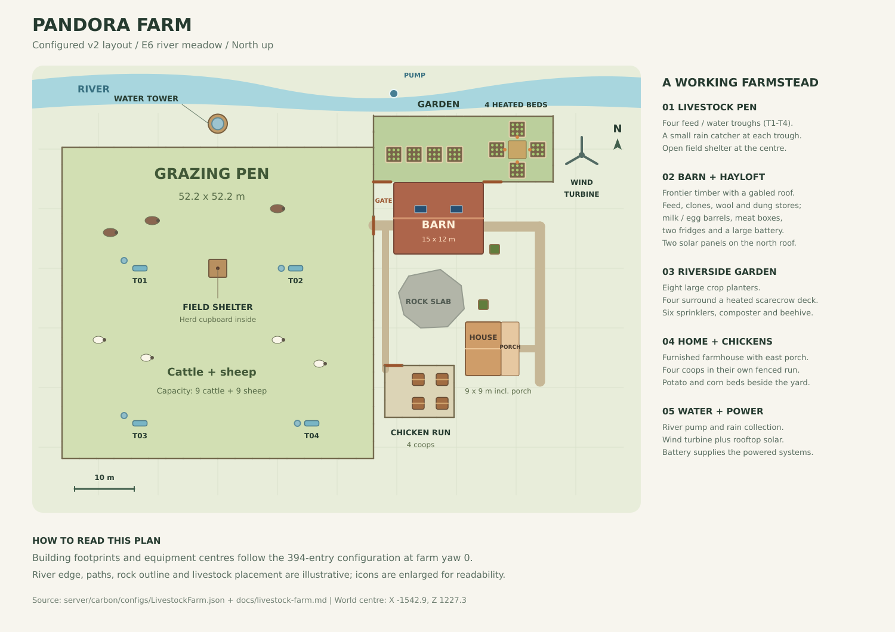

# Livestock farm

`server/carbon/plugins/LivestockFarm.cs` is a local Carbon plugin that builds one farm per server identity and keeps essential
care running, with configurable automatic or player-managed production. The layout in `server/carbon/configs/LivestockFarm.json`, which is also the plugin's
built-in default (v2 with visitor, lighting, and market additions, 422 entries), makes it a farmstead in Frontier timber: cattle and sheep in a fenced pen
around a field shelter, a barn by the pen gate that holds the stores, a public market by the barn entrance, a farmhouse, a water tower, a Wind Turbine, a
fenced garden of eight planters, four of them heated, two self-replanting static planters, and a chicken run of four
coops. The crops feed the animals, the animals' dung fertilizes the crops, rain and the river supply the water, the
turbine and two roof panels power the fridges, lights, heaters, and pump through one battery, and the plugin creates
feed, water, or lantern fuel only when a stock runs low, logging every such top-up. `farm.upgrade` turns a standing farm of the first
layout (v1 below, 94 entries) into v2 in place. v2 was tested on Rust buildid 25823813 with Carbon 2.1.1287;
[livestock.md](livestock.md) covers the game mechanics it builds on.

## Site and layout

The plan follows the configured building footprints and equipment positions. The river edge, paths, rock outline,
and animal positions are illustrative; equipment symbols are enlarged for readability.

The layout centre is the herd's cupboard on the E6 river meadow of Pandora (seed 1739235182, worldsize 4500), world
(-1542.9, 1227.3), about 2.5 m above sea level, at farm yaw 0; positions below are farm-local metres, X east and Z north
of it. A survey of the map's own height, topology, biome, and water layers, its rock and cliff colliders, and the trees
and bushes of the world save chose the meadow for open grass, gentle slope, the river beside it, at least 50 m to roads
and rails, and at least 150 m to monuments. The only flat ground at the pen gate inside those limits is the strip east
of the pen, 28 to 39 m wide between the east fence (X 26.1) and Road 20's 50 m line, from the river (dry land ends at
Z 26.5) south to Z -25, with a rock slab (collider half extent 6.5 m) at (35.3, -6.0) in its middle. The noon sun stands
in the north except from November to February (latitude -10), so the garden lies north of the barn and the roof panels
in the barn's north roof plane.

Every entry was checked against the map and the game's rules before the build: ground contact of each prefab's area
checks and of the plugin's own ground check, slope limits, rocks and trees under footprints, water, the distances at
every footprint corner, each building's base height, socket links, support, and stability, door steps, gate and door
swings, hose and wire lengths, the line to the sun of the coops, panels, and planters over a year, and the turbine's
wind line.

| Group | Entries | Parts | Where |
| --- | --- | --- | --- |
| Pen | 88 | 71 animal fences and a gate; 4 Hitch & Troughs, each with a small water catcher; the field shelter (7 blocks) over the herd's cupboard | 18 by 18 segments, 52.2 by 52.2 m, X -26.1 to 26.1, Z -31.9 to 20.3; gate on the east side at (26.1, 7.2) |
| Barn | 142 | 90 blocks; 5 double doors, a hatch, and 4 window bars; 12 boxes and barrels, 2 fridges, a large battery, 2 roof panels, 6 ceiling lights, 2 combiners, 2 splitters, 4 torches, the barn board, an entrance guide, 8 storage labels, and a lighting switch | X 29.5 to 44.5, Z 2.4 to 14.4; west doors 3.4 m from the pen gate |
| Garden | 44 | 19 fences and 2 gates; 8 large planters and 6 sprinklers; the scarecrow deck with 4 electric heaters; a composter, a beehive, and the water pump | north of the barn, X 26.1 to 56.2, Z 14.5 to 25.5; the pump in the river at (29.5, 29.3) |
| Chicken run | 18 | 13 fences and a gate; 4 chicken coops | X 28.0 to 39.6, Z -25.0 to -16.3, south of the slab |
| Farmhouse | 70 | 39 blocks; 2 doors, 6 shutters, and 6 glass windows; 17 furnishings and lights, the owner's bed among them | X 41.5 to 50.5, Z -18.0 to -9.0, porch facing east |
| Water tower | 16 | 11 blocks; a door and a hatch; a large water catcher, a fluid splitter, a torch | (0, 24.25), north of the pen |
| Yard and paths | 16 | Wind Turbine, town sign, mailbox, well, bench, log pile, 8 lanterns, 2 static planters | east of the barn; turbine at (61.0, 19.0), town sign at (52.9, -0.9) |

The five buildings stand on their own foundations, every block Frontier wood (wood grade, skin 10232) at 250 health:

| Building | Cells | Base height T | Max rise | Blocks | Inserts | Other parts | Socket links | Lowest stability | Height |
| --- | --- | --- | --- | --- | --- | --- | --- | --- | --- |
| barn | 5 by 4, 15 by 12 m | 1.19 m | 0.40 m | 90 | 10 | 32 | 942 | 0.077 (second roof course) | 9.1 m |
| farmhouse | 2 by 3 and a porch row, 9 by 9 m | 1.74 m | 0.37 m | 39 | 14 | 17 | 378 | 0.262 (roof) | 6.1 m |
| water tower | 1 | 0.74 m | 0.04 m | 11 | 2 | 3 | 68 | 0.758 (storey-1 frames) | 10.4 m with the catcher |
| field shelter | 1 (foundation-01) | 2.77 m | 0.46 m | 7 | 0 | 0 | 20 | 0.257 (lean-to roof) | 4.5 m |
| scarecrow deck | 1 | 0.78 m | 0.02 m | 1 | 0 | 5 | 0 | 1.0 | 0.1 m |

T, the top of a building's foundations, is the value the test server took from the terrain (Building it); the rise is
the most any foundation stands above the lowest ground at its corners, where the planner's limit is 2.6 m. `farm.links`
counts each socket link from both ends, and a block collapses below stability 0.05. Pieces are named
`<building>-<kind>-x<i>z<j>`, plus the wall edge (`-N`, `-E`, `-S`, `-W`) and the storey (`-s<n>`, or `-h1` for the
shelter's pieces 1.5 m up) where they apply; foundations carry neither (`barn-fnd-x0z0`).

### Barn

The barn stands directly east of the pen gate, cell (0, 0) centred at (31.0, 3.9): 20 foundations, ground-storey walls
with two window walls on each long side and two wall frames in the middle of each gable end, a hayloft of 19 floors and
a floor frame 3 m up, and a gable roof with its ridge east-west 9 m up, eaves at 3 m, and closed gables. The wall frames
hold four double doors: the west pair faces the pen gate 3.4 m away, the southern one in line with it (Z 6.9 against
7.2), and the floor stands 0.27 to 0.43 m above the ground at the gable doors, under the 0.505 m step the navmesh climbs
beside building blocks; the east pair opens on the farmyard under the barn board, a `sign.huge.wood` mounted on the
storey-1 east gable 3.55 m up. A hay door (a double door in a storey-1 wall frame) faces the pen, a ladder hatch in the
floor frame leads to the loft, and wooden bars fill the four windows. Four torches flank the door pairs outside.

On the foundations inside stand, along the north wall, two food boxes (feed; they show what they hold), a large box
(clones), and three lying barrels (dung, wool, wool); along the south wall, the two fridges, three upright barrels
(milk, eggs, eggs), three large boxes (meat), and the large battery; on the inner face of the east wall, the two
combiners and two splitters of the power circuit; and under the loft, six ceiling lights. The fridges' area checks see
only building blocks and large vehicles, never terrain, which is why they stand on the barn's foundations. The two roof
panels lie in the north roof plane, in the upper course, over the garden.

### Farmhouse

The farmhouse stands south-east of the yard, its porch and front door facing east toward the lane from Road 20: 2 by 3
cells plus a porch row of 3 foundations, a gable roof running north-south 6.1 m up, and a flat porch roof of three
floors on wall-frame posts. A partition with an inner door separates the bedroom (the south row) from the living room,
and six reinforced glass windows carry wooden shutters. Inside: the owner's bed (`bed_deployed`, whose deployer the
plugin sets to the owner), two rugs, a small candle set, a hearth (`fireplace_on.static`) against the west wall, a
rocking chair, a table with two chairs and a large candle set, and a cooking workbench; on the porch a second rocking
chair, a bench, two lanterns, and two torches by the front door. The railway potato bed stands by the north gable.

### Field shelter

foundation-01, which carries the herd's cupboard at the layout centre, is the shelter's floor: half walls on its south,
west, and north edges, plain walls on the south and north half walls as the side triangles, and a lean-to roof rising
from 1.5 m over the west half wall to 4.5 m over the open east side, which faces the gate. That side steps 0.08 to
0.41 m up to the floor, and the cupboard has 1.0 m of headroom.

### Water tower

The tower stands north of the pen, 27 to 28 m from trough-01 and trough-02: a pump-house storey of three walls and a
doorway with a door, an open storey of four wall frames on a floor frame with a ladder hatch, and a floor 6 m up
carrying the large water catcher. A fluid splitter on the pump house's north wall, 2 m up, feeds both troughs by hose; a
torch hangs by the door.

### Scarecrow deck

One foundation at (50.2, 19.9) in the garden carries the scarecrow, and an electric heater stands on the ground against
each of its four sides, with a large planter beyond each heater, 1.93 m from it. A heater's ground checks need a wall
face or a foundation side right behind it; against the deck all four of each heater pass, so the heaters do not depend
on the plugin's ground veto.

### Pen

The pen is the v1 pen grown 4 segments (11.6 m) south: 26 new fences carry its sides down to a new south line at
Z -31.9, and the 18 v1 south fences are retired once that line stands. It holds 2,679 m2 of grazing grass, 149 m2 a head
for the 18 animals the caps allow, as 14 had on the v1 pen. A grazed patch regrows after 30 minutes
(`livestock.overgrazedareacooldownminutes`), and 8 adults stripped a 404 m2 test pen in about 8 minutes, which puts the
need at 150 to 250 m2 per grazing adult: the pen feeds 10.7 to 17.9 of the 18, and the troughs carry the rest. Four
troughs face into the pen at (-13.05, 0), (13.05, 0), (-13.05, -26.0), and (15.75, -26.0), each with a small catcher
beside it, and no point of the pen is more than 23.7 m from one. Every new fence passes the v1 fence rules: no rock
collider, tree trunk, water, road, or rail under it, and at most the player's 0.13 m of curvature along it.

### Garden, yard, and chicken run

The garden lies on the river bank north of the barn, whose north wall closes its south side between two gates; 19 animal
fences close the rest. Off the pen's 2.9 m lattice their spacing is 2.6, 3.01, and 2.75 m, so posts overlap by up to
0.4 m or leave 1 cm gaps. Planters 1 to 4 stand in a row at Z 19.1 with a sprinkler each, 2.2 m away. East of them,
planters 5 to 8 form a cross around the scarecrow deck, each warmed by its heater, and two more sprinklers at the
cross's diagonals water two planters each from 2.8 to 2.9 m (reach 3 m). A composter stands in the north-west corner and
a beehive by the north fence, and the pump stays in the river.

The farmyard east of the barn holds a hand-pump well, a bench, and the minecart corn bed. Two static planters grow crops
the game replants itself every 240 s at god quality, with no water, fertilizer, clones, or power: a
`railroadplanter.respawning.static` (9 potato slots) at (44.5, -6.1) and a `minecart.planter.respawning.static` (3 corn
slots) at (46.4, 3.2). The plugin only harvests them.

The chicken run, 4 by 3 segments (11.6 by 8.7 m), lies south of the rock slab beside the farmhouse, its gate toward the
path that runs from the pen gate along the slab's west side. Its four coops stand 2 by 2 at X 33.6 and 37.6, Z -18.65
and -22.65, with a clear line to the sun for 8.6 to 9.9 in-game hours a day in the worst month; the farmhouse shades
them in the morning.

### Lights and signs

Ten controllable `lantern.deployed` fixtures (eight along the paths, two on the porch), the six barn ceiling lights,
and the market's two ceiling lights, which continue the same chain, follow the farm's dusk/dawn schedule: on from 18:30 to 07:30 by default, checked every upkeep pass (30 s).
A dedicated switch on the barn lighting branch leaves the fridges, pump, and heaters supplied during daylight.
Lanterns burn normal Low Grade Fuel; at night, upkeep adds one unit when a managed lantern has none and logs it as a
`topup` event. Upkeep locks the managed lanterns' fuel slots, so players can neither take the created fuel nor add
their own. Night Lantern is vetoed only for these farm-managed lanterns, so the plugins do not compete. Disabling the
farm schedule, or unloading the plugin, unlocks them and returns them to normal controls and Night Lantern behavior.
The config fails to load when the lighting switch ID or a scheduled light ID names no layout entry of the matching
prefab (`switch.prefab`, `lantern.deployed.prefab`), or when a `lantern.deployed` entry is left off the schedule.

Seven `torchholder_on.static` fixtures (barn 4, farmhouse 2, tower 1), the hearth, and two candle sets remain always-on
accents. Their static prefabs cannot be scheduled by toggling flags.

The barn board (1024 by 256) and town sign (`sign.post.town.roof`, 512 by 256, yaw 106.6, beside the mailbox) carry
PANDORA FARM images. An east-wall entrance guide explains directions, the free market, shared storage, and `/farm`.
Eight small signs label Feed, Clones, Manure, Wool, Cold Store, Milk, Eggs, and Meat above the barn's storage groups;
the market carries a FARM MARKET sign on its fascia and a label over each stall. All use the existing
locked, per-sign tagged image storage and periodic repair. `scripts/farm-signs.py` regenerates the visitor sign PNGs
and embedded C# image table with Python 3.14, Pillow, and a DejaVu Sans bold font; run
`uv run scripts/farm-signs.py --out /tmp/farm-signs` and replace the `ExperienceSignImages` table with the emitted
fragment when changing the text. Pin the font with `--font` when reproducing byte-identical assets.

### Market

The market is an open two-cell pavilion (building `market`, X 49.2 to 55.2, Z 10.45 to 13.45) across the yard in
front of the barn's east doors: a back wall on the north, open frames on the other sides, a flat canopy at 3 m, and a
half-wall fascia carrying the market sign. Four stalls of role `market` stand against the back wall: `market-dairy`
(fridge; milk and eggs), `market-wool` (barrel; wool and cloth), `market-crops` (large food box; potato, corn,
pumpkin, and wheat), and `market-meat` (fridge; beef and mutton). A splitter on the back wall feeds the two fridges
from the barn's second splitter. Crates, a table, and the moved bench (`bench-02`) dress the area.

Every upkeep pass the market step, after spoiled produce and before culling, moves as much of each stall's goods as
fits from the farm's fridges and boxes, freshest spoiling stacks first, but never takes a good's total across farm
storage below its reserve: 640 wheat (one refill of the four troughs at 120 and the four coops at 40) and 4 eggs (a
hatching egg per coop). A good may start new stacks in at most its share of a stall's slots, so one plentiful crop
cannot crowd out the rest. Nothing else ever goes into a stall, and stalls never feed the farm, except that spoiled
produce left in one goes to the coops and composter as from any other store. When `farm.upgrade` retires a stall, its
goods go to another stall first. One `market` event every 10 minutes at most sums what moved; `farm.status` lists each
stall's power, slots, and contents and the totals since load, and `/farm` lists what each stall holds.

### Applying the visitor and lighting additions

The current layout has 394 entries and 30 connections. Upgrading the 384-entry farm places nine signs, a switch, and
ten deployed lanterns; the ten empty static lanterns retire through their `Replaces` links. The first ceiling light
is re-keyed to `barn-light-01-timed` at the same pose with the same network ID, so the upgrade's existing unwiring path
frees the old direct lighting link before inserting the switch. Its five other ceiling lights, livestock, crops,
stores, fridges, and battery remain in place. Reloading the plugin alone does not migrate the fixtures.
The path lantern near the chicken-run gate moves 2.5 m north to keep the gate's operating space clear.
Run `farm.upgrade` to inspect the placement plan, then `farm.upgrade confirm` to apply a plan without blockers. Lighting
status reports an incomplete upgrade while the new switch or lanterns are absent. Preserve a current world and farm
record backup before applying a layout migration.

The market raised the layout to 422 entries and 35 connections. Upgrading the 394-entry farm places its 28 entries,
moves `bench-01` out of the pavilion's footprint as `bench-02`, and wires 5 power links; on pve on 2026-10-23 it placed
28 of 28, wired 5 of 5, and the next dry run reported nothing to do.

## Building it

`farm.build` (RCON, the server console, or F1 at auth level 2) places the config's layout at its centre and yaw.
`farm.build <x> <z> [yaw]` places it at another centre and rotation, without the terrain checks the default spot had.
The build:

- refuses while the identity already has a farm, and takes over a matching standing entity (same prefab, within 0.5 m
  across and 2 m vertically, or 0.1 m for blocks and inserts, owned by the farm owner or nobody) instead of placing a
  second one;
- kills bushes, trees, and resource piles whose colliders overlap a footprint, plus 0.5 m;
- places the entries by `Layer`, then list order: foundations (0), the cupboard (1), fences, gates, and ground-storey
  walls (2), each building's floors, upper walls, roof courses, gables, inserts, and contents (3 to 9), and the other
  outdoor parts last (10); an entry fails when its support (its `Parent`, the block it stands `On`, or for a block every
  lower-layer block of its building within 4.6 m) is not in place;
- gives each building one base height T, the top of its foundations: the highest ground under any of them (sampled 5 by
  5 over each), or the top of a foundation of it that already stands; every piece of the building stands at T plus its
  `Y`. A building is refused when any of its foundations would stand 2.6 m or more above the lowest ground at its
  corners, the planner's own limit. T goes into the record and holds while any block of the building stands; with none
  standing it is worked out again. Each foundation is also checked where it lands: it fails when it would stand 2.6 m or
  more above the lowest ground at its corners, when the ground rises more than 0.05 m above its top, or when it would
  bury another entity;
- grades every block to `Building grade` and `Building skin` (wood and 10232, Frontier) at full health, attached to the
  first standing block of its building; an entry's own `Grade` and `Skin` override them, and a grade the prefab lacks in
  that skin is applied plain and logged;
- sets doors, hatches, shutters, glass, and bars into their openings from the parent block's live pose, closed and
  without locks;
- paints each sign with its image and locks it to the owner; each painted image carries a tag with the sign's network
  id, since FileStorage keys a row by its bytes' CRC alone and a restart would clear one of two signs with identical
  images;
- places the fences and gates rolled to the terrain along their length, every other outdoor deployable aligned to the
  terrain, and the roof panels in the roof plane;
- gives every entity the owner's SteamID, so Auto Doors closes a door, hatch, shutter, or gate 5 s after a player opens
  it, and makes the owner the bed's deployer;
- wires the 30 connections, puts two GGYYYY clones per planter slot into the clone box (144 for the eight planters), and
  15 s later spawns the starter herd 11 m north of the cupboard: 2 cows, a bull, and a female calf; 3 ewes, a ram, and a
  male lamb;
- ends with a world save (`server.save`), which writes the record with the world.

The owner is `Owner SteamID` in the config or, at 0, the first owner in `cfg/users.cfg`, recorded at build time.

## Upgrading a standing farm

`farm.upgrade` prints the plan from the standing farm to the config's layout, and `farm.upgrade confirm` re-plans and
applies it in one synchronous call, so no player, physics event, or ground check sees a half-moved farm. Editing the
layout alone changes nothing that stands: auto-repair skips entries the farm never placed, and `farm.repair` places new
entries but never moves or retires old ones. The dry run and `confirm` locate and check every entry the same way, so a
plan without problems is what `confirm` does. `confirm` runs these steps in order:

1. Unwires every part that moves or is lifted, then lifts every replaced part, and every old part that stands in the
   footprint of a new entry or of a move's new pose, 300 m up while the new entries are placed, until it moves, retires,
   or goes back.
2. Places every layout entry the record does not hold; the plan lists them by building, with the base height each
   building would get. From v1 that is 315 entries. If a placement the plan passed still fails, nothing moves or
   retires, and every lifted part goes back, retired, where it stood.
3. Moves an old part to the new entry that `Replaces` it with the same prefab, and re-keys its record to the new Id, so
   its network id, items, crops, coop chickens and eggs, and battery charge stay. From v1 that moves 8: coop-01 and
   coop-02 into the chicken run (coop-03, coop-04), fridge-01, box-meat, and box-clones into the barn (fridge-02,
   barn-meat-1, barn-clones), composter-01 into the garden (composter-02), and solar-02 and solar-01 onto the barn roof
   (barn-solar-01, -02). A building block, or a part mounted on another such as a sign on a wall, is placed new instead,
   and the old one retires.
4. Retires each record whose Id left the layout: its items go first to the entry that `Replaces` it with another prefab,
   then fridge items to the fridges, then to containers of its own role, then to the item's home box, and eggs never
   into a coop's laying slot; a static planter's ripe crops go to the feed boxes that stay, and its other plants go with
   it; its chickens and hatching eggs go to other coops, its replacement first, at most one hatching egg each; a
   battery's charge goes to the battery replacing it, up to that one's capacity, which the dry run states; then it is
   killed, deployables before the blocks they stand on, and static planters after everything else, so their crops take
   only the feed-box room the other retirements leave. From v1 that retires 25: the other five boxes into the barn's
   barrels and food box, battery-01 into the large battery-02, fence-01 to fence-18 once the new south line stands, and
   platform-01. A lifted part that stays, retired, goes back where it stood.
5. Regrades standing blocks whose grade or skin differs from the layout's (foundation-01, from stone to Frontier wood),
   wires the layout's connections, and drops the links of moved and retired parts (from v1: 25 wired, 3 dropped).
6. Stocks two starter clones per slot of each planter it placed, whatever the clone box holds, as the dry run lists them
   (from v1: corn 28, pumpkin 26, wheat 18).

An Id that stays in the layout keeps its record where it stands, even when its layout pose or prefab changed, and the
plan reports it as kept: moving a part takes a new Id with `Replaces`. Its record takes the layout's role when the
plugin loads. `confirm` refuses, changing nothing, while a problem blocks it: an entry or a move whose pose fails its
checks, such as the ground check; an entry whose prefab does not exist or does not fit its role (a block, door, insert,
cupboard, or bed role on another kind of prefab); a building whose base height is refused; a foundation that would bury
something the upgrade does not lift, move, or retire; a deployable that is not the farm's standing on a block or a farm
deployable that retires or moves; a player or a live cow or sheep within 0.5 m of a new
footprint; a part the layout keeps reaching more than 0.2 m into one (fences and gates meeting each other, and parts of
or on the same building, excepted); a plan that would retire the herd's cupboard or move or retire the block under it; a
retiree that must stay standing inside a new footprint; or items or water with no room.

A record the upgrade could not empty, move, or kill stays tracked as retired, protected and taking no new items: a
planter is harvested until it is empty, a coop's chickens are fed but the coop is never refilled, and a trough is no
longer stocked. `farm.status` lists it, and the next `farm.upgrade confirm` retries it. Right after an upgrade from v1
the large battery holds only the small one's charge (3,853 of 1,440,000 rW s in the test) and the new turbine reports 0
until its first update, about 20 s later.

## Upkeep

Every 30 s the plugin runs these steps in order, each entity in its own guard, so one failure skips only that entity:

1. Structures: re-place any missing layout entry (`Auto repair missing structures`) in layer order, re-authorize the
   owner on the cupboard, and close each gate when no player is within 10 m. Fences and gates come back on every pass.
   Other entries wait 10 minutes after a failed placement, or after a loss within 10 minutes of their last repair, and
   the wait doubles up to 2 hours each time that repeats. Any entry waits while a player or an animal stands on its spot
   or while its support is missing; an entry the farm never placed waits for `farm.repair` or `farm.upgrade`, and one
   that either of them deferred is retried until it stands. The same step puts back the recorded grade and skin of every
   farm block, with full health when the grade changed, logged per building at most hourly, except a block whose entry
   left the layout or no longer grades it, which players may upgrade and which keeps what they give it; checks each
   sign's image every 300 s, repainting it when the image is gone and relocking it when the lock is; removes a part
   whose parent was lost so that it comes back after the parent, except one holding items, plants, chickens, or
   hatching eggs, which stays; and makes the farm bed private and the owner's again when it was made public, claimed,
   or handed over.
2. Wiring and lighting: re-make any missing link, except a pump link when the pump's water is not fresh, and skip links to an entry
   the farm never placed. A link whose route anchor is missing is still made, drawn straight. Refresh a connected link's
   drawing when its configured route differs, without disconnecting its sockets or interrupting its supply. Then set
   the dedicated lighting switch and managed lanterns for the time of day; failures are isolated per lantern.
3. Sweep: dropped dung and eggs within 75 m go into storage, eggs into a fridge first.
4. Herd: full trust (900 s) for the owner, the farm cupboard as home, milking and shearing into storage when the profile or absence care enables them, and
   the needs net: fullness, hydration, or personal space below 0.5 is set to 0.8 and logged. A wild animal standing
   inside the pen, the fence loop around the herd point (0, 11), joins the herd while its species is under the cap; the
   garden and the chicken run are outside it. Wild means no player has ever bonded it (`DecayStarted` false, which the
   game sets for good once an animal can be led), so an animal bought from the Livestock Vendor or tamed by a player
   never joins, even after its trust fades. A farm animal outside the fence for 5 minutes and not on a lead or a vehicle
   goes back to the pen, from any distance, through the same move the game uses to unload an animal from a vehicle. One
   a player leads or drives out past 75 m from the centre leaves the farm for good, and the plugin never touches it
   again.
5. Sex safety: a species with no male or no female gets a juvenile of that sex, and a species with no animals gets its
   starter herd again, each at most every 10 minutes, doubling up to 2 hours while the reseeded animals die or when a
   release left the gap.
6. Breeding: hold mating while the hold rules apply (Herd); after 60 minutes without a new pregnancy while under the
   cap, an eligible female is made pregnant by an eligible male, retried every 10 minutes.
7. Crops: hold soil water at the planter's ideal 60% and fertilize. In automatic beds, harvest ripe plants and take
   clones from saplings while
   the clone stock is short, clear dying plants, and replant empty slots. The static planters are only harvested: ripe
   plants into the feed boxes, dying ones cleared so that the game replants the slot.
8. Compost and bees: dung into the composter, fertilizer out to the dung barrel; initialize an empty, unseeded hive
   once, leaving native honeycomb production and manual collection intact.
9. Chickens: eggs out, feed, water, and petting; a coop short of chickens hatches a stored egg.
10. Troughs: feed and water.
11. Spoiled produce: to the coops first (chickens eat it), then the composter.
12. Cull: when automatic culling is enabled and a species is over its cap, one adult is killed and butchered into storage (Herd); a juvenile never is.

## Assisted farming

The tracked configuration runs fully automatic: upkeep milks, shears, and harvests and replants every bed whether or
not a player is nearby, and `/farm` reports `Production: fully automatic`. The assisted profile is optional: it
reserves milking and shearing for players and makes beds such as `planter-07` and `planter-08` (the heated beds east
and south of the scarecrow) player beds, while the other beds remain automatic. Existing crops stay in place when
switching modes. In the assisted profile, `/farm` reports ready cows, sheep with harvestable wool, ripe
player crops, empty player-bed slots, production settings, and surplus livestock. `/farm help` explains the native
interactions. Longer status output is sent in bounded chat messages; `farm.summary` previews the same content.

Milk a cow using its native interaction prompt after it trusts the player. The farm owner already receives the
plugin's bond; visitors still need native trust. Shear sheep with a suitable shearing tool. Production goes directly
to the player through normal game interactions; no new permissions or visitor policy are introduced.

Player beds retain automatic soil-water and fertilizer care. While attended, upkeep does not harvest, clone, clear,
or replant their plants. Choose crops and collect them normally. Player beds are excluded from automatic clone-stock
quotas, and stored clones are never removed when changing the setting.

An awake, connected, living player within the configured farm radius refreshes attendance each upkeep pass. Sleeping,
disconnected, dead, and NPC players do not count. After 60 minutes without such a visit, absence care resumes automatic
milking and shearing and collects ripe player crops into the feed stores when they have room. It preserves the crop's
native harvest counter and lifecycle, including repeat harvests; player beds are never replanted or cloned. Already
dying plants remain for players. This does not freeze plant age or guarantee produce against a full store. Feed,
water, essential animal needs, and the remaining automatic beds continue in either mode. The saved last-visit epoch
survives reloads. Reading status does not refresh attendance. Set the absence interval to `0` to keep manual jobs
reserved indefinitely.

Automatic culling is explicitly enabled in the tracked profile, retaining the existing protected breeder and juvenile
rules. Turning it off prevents new culls; existing pending corpse handling completes. Without automatic culling,
breeding holds when counted animals plus the maximum young from current pregnancies reach the species cap, and status
explains the hold. Existing pregnancies and natural aging continue.

| Configuration key | Tracked profile | Effect |
| --- | --- | --- |
| `Automatically milk cows` | `true` | `false` reserves milk for players until absence care applies |
| `Automatically shear sheep` | `true` | `false` reserves fleece for players until absence care applies |
| `Automatically cull surplus livestock` | `true` | Apply existing guarded surplus culling |
| `Player-managed planter layout IDs` | `[]` | Beds excluded from automatic planting and normal harvesting |
| `Assisted farming absence fallback after minutes (0 = disabled)` | `60` | Grace after the last nearby awake player; unused while nothing is player-managed |

For assisted farming, set either production boolean to `false` or list player beds, for example `["planter-07",
"planter-08"]`. The built-in defaults are the fully automatic profile. No layout upgrade is required for this mode
change.

## Bees and honey

The garden hive needs a bee nucleus in its first inventory slot before the native honeycomb cycle can run. The farm
initializes an empty hive with one native starter nucleus once per physical hive. An existing nucleus, its experience,
and its progress are preserved. Removing the nucleus does not generate another for the same hive; place one manually
to restart it. A repaired replacement hive receives its initial colony when its network identity changes.

Honeycomb remains in the hive for manual collection. Leave the nucleus in place, take the comb, and use its native
Extract action to obtain honey or a chance of another nucleus. The farm does not manufacture honey or accelerate
colony experience. Outdoors, temperature, rain, nucleus grade, and available inventory space govern native production.
At a starter growth rate of `0.05` in heavy rain, the native 120-second cycle adds about `0.1` comb progress per tick,
so the first comb takes roughly 20 minutes. The visible bee effect starts only after honeycomb exists; an initially
quiet hive can still have an active colony.

`/farm` reports available honeycomb, progress toward the next comb, and basic colony conditions. `farm.status` also shows nucleus grade, temperature,
rain, and the native growth rate. A missing colony or indoor/full hive is reported explicitly.

## Feed, water, and power

| Stock | Target | Created below | Sources, in order |
| --- | --- | --- | --- |
| Trough feed (Food items) | 120 | 20 | spoiling produce, oldest first; fresh produce; wheat |
| Trough water (ml) | 5,000 | 1,000 | the catchers, fullest first; the pump, below the minimum only; created water |
| Coop feed (items) | 40 | 5 | spoiled produce, then the same as the troughs |
| Coop water (ml) | 1,000 | 200 | the catchers, fullest first; the pump, below the minimum only; created water |

Each of the 4 troughs and 4 coops has these targets. Besides the plugin's top-ups, the tower's large catcher (50 L,
about 39.8 L a day in clear weather) feeds trough-01 and trough-02 by hose through the fluid splitter, with the hoses
following the tower and ground. Trough-01's inlet is 0.83 m above the splitter's outlet, within the 1 m an unpowered
source can lift. The 18
animals and 16 chickens drink about 2.3 L a real day, and each small catcher collects about 13.7 L a day in clear
weather.

The pump keeps at least 500 ml for the sprinklers and runs around the clock on the battery. It feeds the six sprinklers
in a chain, which drain 12 ml/s against the pump's 8.5 when all run, so they cycle and the plugin's soil hold makes up
the difference.

Created feed is wheat (`Fallback feed shortname`), which never spoils. A cow or sheep living off a trough eats up to 14
potatoes an hour of daylight. With GGYYYY clones and the server's 2x gather, the model puts the planters at about 95,000
calories an hour: 19,634 for each potato planter, 3,592 to 6,663 for the corn, pumpkin, and wheat planters, 20,288 for
the potato bed, and 2,701 for the corn bed, against 16,100 to 26,900 for 18 animals with no grass at all. The two feed
boxes fill in about 5.5 hours; while they are full, ripe crops wait in their slots, die after 24 hours, and are
replanted.

Crops follow `Planter slot plan`: planters 1 and 2 grow potatoes, planter 3 corn and pumpkins in alternate slots,
planter 4 wheat, and around the deck planter 5 corn, planter 6 pumpkins, planter 7 wheat, and planter 8 corn and
pumpkins. An electric heater adds 10 C to a planter whose centre is within 2.8 m of it, falling to 0 at 4 m; corn,
pumpkin, and wheat grow below full temperature quality on this site without one, and the model gives the heater 9 to 11%
more yield for them and 2% for potatoes, since light limits most of the day. With the GGYYYY genes and the 2x, a plant
at full quality gave about 41 potatoes, 20 corn, 20 wheat, or 10 pumpkins in the v1 test.

Planted crops never give seeds, so every replant comes from clones. A plant reaching the sapling stage is cloned while
the clone box holds fewer of that crop than its slots, and the clones keep its genes. A crop with no clones left and a
slot empty for 10 minutes gets fresh GGYYYY clones, logged. Harvests, the static planters' included, go through the
`OnGrowableGathered` hook, so Carbon's GatherManager gives them its 2x.

Sprinklers would keep the soil at 100%, which costs up to 29% of growth and yield, so the plugin holds it at the
planter's ideal 60% and fills new planters to that level. A planter under 25% for 10 minutes without rising, as when the
pump or a sprinkler fails, is filled to 60% directly, and the log names what it found, such as an unpowered pump or a
missing link.

The composter turns one dung into 10 fertilizer every 60 s, and the plugin feeds it only while the dung barrel has room
for what it will make, since a full composter drops its output on the ground. Each plant takes one fertilizer.

All power runs through the large battery in the barn, wired as the layout's 26 power connections:

| From | To | Load |
| --- | --- | --- |
| Wind Turbine and roof panel 1 | combiner 1 | |
| combiner 1 and roof panel 2 | combiner 2, then the battery | |
| battery | splitter 1 | |
| splitter 1, output 0 | splitter 2, then fridge-02 and fridge-03 | 5 each |
| splitter 2, output 2 | the market splitter, then the dairy and meat stall fridges | 5 each |
| splitter 1, output 1 | lighting switch, then six barn and two market ceiling lights in a chain, each passing its input less 2 | 2 each at night |
| splitter 1, output 2 | four heaters in a chain, each passing its input less 3, then the pump | 3 each, pump 5 |

The 9 water connections run from the pump through sprinklers 1 to 6 and from the tower's catcher through the splitter to
trough-01 and trough-02. The loads take 53 power at night and 37 during daylight: fridges 20, lights 16 when on, heaters 12, pump 5. The meat
stall gets exactly the 5 a fridge needs, and every splitter output is in use. The
battery stores 1,440,000 rW s, gives up to 100 power, and charges at up to 320 a second. The turbine gives 0 to 150,
68.4 on average in a model of the server's own wind noise (33 or more 90% of the time, under 10 for 0.7% of it and never
for more than 6.3 minutes), and no building rises into its wind line from any direction. Each roof panel gives 39,561
(December) to 44,727 (April) rW s per 70-minute day, about 10.2 power on average, with nothing in its sun line.
In a 21-day simulation with the market and lights on around the clock, starting with a half-charged battery, every
load stayed powered, the battery never fell below 49.4%, and it was full 57% of the time (83% before the market); from an empty battery at a fresh build each load
waited about 1 s in a run of 3 in-game days (3.5 hours).

The connections' `Route` lists run from output to input. Roof-panel cables follow the north roof plane and east gable;
barn wiring follows floor edges or the underside of the hayloft, and outdoor cables and hoses lie on whatever is under
them: terrain, rocks, foundations, the scarecrow deck, or planters.
The tower hose descends beside a frame post. Each route point has `X`, `Y`, and `Z`: with `Anchor`, they are metres in
that layout entity's local space; without it, `X` and `Z` are farm-local coordinates and `Y` is height above the
surface under the point (the highest block, deployable, rock, or terrain, never the link's own two ends). Ground runs
sample that surface at intervals of at most 2 m, including the stretches from each end down to the first and last
ground waypoint. Each route may contain up to 64 waypoints; their coordinates must be finite and anchors must name
layout entries. A missing anchor reports the problem: a connected link keeps its drawing, an unconnected one is wired
straight, and both take the route again once the anchor is back. Omitting `Route` preserves the straight drawing used by older
layouts. Routed lengths can exceed the wire tool's manual placement limit; these are plugin-managed connections.
`farm.status` reports whether each link matches its route, its drawing point count, and its routed length. The first
wiring pass after a reload updates an existing farm. Later passes, and `farm.status`, reuse a connected link's computed
drawing until one of its ends or anchors moves or is replaced; a collider placed under a ground run is picked up then
or at the next reload.

## Herd

`Cattle cap` and `Sheep cap` are 9 each, counting adults and juveniles, except a juvenile that sex safety spawned, which
counts only once it grows up. Nine is the most each species can hold without crowding. Personal space, which natural
breeding needs above 0.5 in both partners, drifts toward the lower of two loads: the packing of animals within 2.5 m,
and the herd load, which counts same-species mates within 20 m, infants included, staying at 1.0 up to 8 mates and
falling linearly to 0.3 at 12. Nine head keep the herd load at 1.0 even with the whole species within 20 m, and the
breeding hold keeps births to about 2 over the cap (below): 11 head give 0.65, still enough for breeding, where a cap of
10 would allow 12 head and 0.475. Cattle and sheep never count each other, so the herd is 18.

Over a cap the plugin culls one animal per pass, and never a juvenile: a calf's, bull calf's, or lamb's corpse yields
nothing. While the heads exceed the cap, an adult male beyond one goes, oldest first; while the adults alone exceed it,
the oldest open adult female goes while another adult female stands. It never takes a pregnant or calving female or the
last adult of a sex, and a herd over its cap only by juveniles waits for them to grow up, which the log notes once. It
kills the animal the way `DieOffNavmesh` does, waits for the corpse, and butchers it through the `OnDispenserGather` and
`OnDispenserBonus` hooks, so GatherManager's 2x applies: a cow gives 40 beef, 200 bone fragments, 80 animal fat, 200
leather, and 60 cloth; a sheep 24 mutton, 100 bone fragments, 40 fat, 40 leather, and 20 cloth, plus twice any wool it
carried. A cull waits until storage has room for the whole yield.

The plugin holds a species' mating while its heads plus the young its current pregnancies can bear reach its cap plus 2,
and while a cull is due but cannot run, because storage has no room for the yield or no adult may be culled. A pregnancy
can bring 1 young plus the mother's Fertility gene scale above 1, rounded up, at most `livestock.maxlittersize` (3), so
births can still pass the cap by a little more than 2: a pregnancy begun one head short of the hold can bring twins,
and several can begin within one 30 s pass. While held, every open adult female gets a 90 s breeding cooldown (3 upkeep
intervals), renewed every pass, so no mating path, vanilla or the fallback, starts a pregnancy; a longer cooldown of her
own is left alone, pregnancies already begun go on, and the hold lapses within 90 s of its cause ending. The log notes
when a hold starts and ends (`breeding: <species>: mating held: <why>`, `breeding: <species>: mating no longer held`),
and `farm.status` shows each species' hold and what its cull waits for.

Aging is untouched: juveniles grow up, and adults die of old age, which goes through `Die` directly, so the damage block
does not stop it. Neglect does not go through damage either; the needs net keeps contentment at 0.5 or more, where a
condition below breeding's 0.6 pause cannot set in.

## Access and helpers

Every player may use the farm's storage, market, animals, and equipment; nothing refuses a visitor. Helpers are the
players on the owner's current Rust team. While `Owner team members are farm helpers (cupboard authorization)` is true,
the helpers step authorizes each team member on the farm cupboard, which gives building privilege at the farm, and
remembers them; a remembered helper who leaves the team, or every helper when the setting is off, is deauthorized.
Anyone who authorized at the cupboard themselves stays, and the owner is never removed. An online player gets a chat
line on either change, and each change is logged as a `helpers` event.

| Configuration key | Default | Effect |
| --- | --- | --- |
| `Stock the market stalls` | `true` | Run the market step |
| `Market stall goods (layout id to shortnames)` | dairy milk, egg; wool wool, cloth; crops potato, corn, pumpkin, wheat; meat beefmeat, muttonmeat | What each stall offers |
| `Market reserve kept in farm storage (shortname to items)` | `{"wheat": 640, "egg": 4}` | Stock the market never takes |
| `Owner team members are farm helpers (cupboard authorization)` | `true` | Sync the farm cupboard with the owner's team |

The config fails to load when a stall id names no `market` entry, a goods list is empty or repeats, a shortname is
unknown, or a reserve is negative. A stall missing from the world is reported and skipped.

## Products and storage

| Role | Containers in the barn | Slots | Fills with no player in about |
| --- | --- | --- | --- |
| fridge (milk, eggs, raw meat) | 2 fridges | 96 | 7.4 h |
| box_milk | 1 upright barrel | 48 | 18 h after the fridges |
| box_eggs | 2 upright barrels | 96 | 20 h after the fridges |
| box_meat (meat and corpse goods) | 3 large boxes | 144 | 21 h after the fridges |
| box_wool | 2 lying barrels | 96 | 29 h |
| box_dung (dung and fertilizer) | 1 lying barrel | 48 | 145 h |
| box_feed (harvests) | 2 food boxes | 96 | 5.5 h |
| box_clones | 1 large box | 48 | clones only |

The times are fully automatic profile upper bounds at 9 cattle, 9 sheep, and 4 coops: about 54 milk, 187 eggs, 141 beef, 85 mutton, 657
wool, and 66 dung an hour, plus corpse goods and about 700 crop items. Milk, eggs, and raw meat go into the fridges,
whose prefab stops spoilage while powered, and into their boxes when both are full. Wool, dung, leather, fat, bones, and
cloth go into their boxes. The containers of one role fill in layout order: the first with room takes the items. The
plugin never drops an item: when every container of a role is full it skips the action, so a ripe crop stays unharvested
and milk or wool stays on the animal, and logs that at most once an hour per role. Vanilla still destroys a coop's eggs
when its egg slot is full.

## Protection

`OnEntityTakeDamage` cancels damage to farm entities and their children (chickens, plants, trough water ends) unless a
real player deals it, `OnNpcTarget` stops NPCs and predators targeting farm animals, and `OnEntityGroundMissing` keeps
farm entities standing. A player's attacks, F1 kills, old age, and neglect still go through. Farm structures cannot be
picked up with a hammer (`CanPickupEntity`, which tells the player in chat that the part `is part of the livestock farm:
remove it from the farm layout in the config`) or taken down with Remover Tool's `/remove` (`canRemove` and
`CanAdminRemove`, which give the same reason): auto-repair would put a new one in place, so the player would keep a free
copy. Coop chickens' unhappiness damage uses `Hurt`, so they cannot die of neglect.

Farm blocks refuse a player's upgrade or reskin from the hammer (`CanChangeGrade`), demolition (`CanDemolish`,
`OnStructureDemolish`), rotation (`OnStructureRotate`), wallpaper (`OnWallpaperSet`, `OnWallpaperRemove`), and building
pieces or wallpaper placed against them (`CanBuild`); deployables still go onto them, so the owner can furnish the barn
and the farmhouse, and seeds and clones go into the farm's planters. A spray can reskins no farm part
(`OnEntityReskin`): its skin swap would replace a large box, the cupboard, or a planter with another prefab outside the
farm, and auto-repair would place a second one. Only the owner may put a code lock or a door closer on a farm part
(`CanDeployItem`); anyone else gets the no-permission message. Nobody can make the farm bed public (`CanSetBedPublic`).
Building Skins reskins through `ChangeGradeAndSkin` with no hook to refuse, so the plugin restores instead: a hammer hit
or upgrade on a farm block (`OnHammerHit`, `OnStructureUpgraded`) puts its recorded grade and skin back one tick later,
and the structures step does the same on every pass, which undoes `/bskin build`, `/bskin all`, the tool cupboard
button, and admin commands such as `entid setgrade` within 30 s. Farm signs refuse every repaint, lock, and unlock,
admins included (`CanUpdateSign`, and `BlockUnlocking` on the sign). A farm block or insert that passed its first
stability check never collapses (`OnEntityStabilityCheck`), so losing a wall costs only the wall, and auto-repair
re-places it under the roof that still stands; a hammer then shows the old stability, and a gable shows as a plain wall
while its roof is missing. When a building splits, `OnBuildingSplit` re-attaches the cupboard to the farm foundation
under it. None of these refusals, nor Auto Doors on the farm's doors, has run with a connected client yet
(Verification).

## Commands

Players can use `/farm` in chat for a read-only summary of herd and coop counts, trough water, garden dryness,
refrigeration, lighting, and storage groups with no free slots. Parts `farm.upgrade` retired are left out. Missing equipment and full storage include suggested
next steps. Occupied slots are distinguished from stack capacity, and existing container access remains public.
An `Access` line names the owner and the helpers (the owner's team) and says everyone may use storage, animals, and
equipment, and a `Market` line lists each stall's contents. `/farm help` mentions the market and helpers.
The command has a five-second per-player cooldown. Directions on the guide and summary describe the default yaw-0
farm. Administrative commands follow:

| Command | Effect |
| --- | --- |
| `farm.build [x z [yaw]]` | place the config's layout and schedule the starter herd |
| `farm.upgrade [confirm]` | print the plan from the standing farm to the config's layout; with `confirm`, apply it |
| `farm.status` | herd with each species' cull wait and mating hold, helpers, the market, chickens, planters, pump, wiring, power with each fridge's supply, buildings, inserts, decor, signs, the pending upgrade, container contents, totals, missing, waiting, and retired parts, events |
| `farm.summary` | preview the compact player-facing `/farm` summary from the console |
| `farm.links <building>` | the building's base height and one JSON line per piece: network id, prefab, stability, grade, skin, health, and socket links |
| `farm.tick` | run one upkeep pass now |
| `farm.relink` | find farm animals again after something replaced them |
| `farm.repair` | place every missing, failed, or never-placed layout entry, take over matching standing entities, rewire, and turn auto-repair back on after a record drift, recording where the drifted structures stand (Records) |
| `farm.remove confirm` | drop every container's items as loot bags, list them, and remove the farm and its animals |

Each needs RCON, the server console, or auth level 2. While the server is still loading the world, before the plugin has
checked its record against it, every command but `farm.status` refuses and says so.

## Config

`server/carbon/configs/LivestockFarm.json` holds the owner, the upkeep interval (30 s), the farm radius (75 m), the
starter herd, the caps (9 and 9), the breeding fallback timing, the needs threshold (0.5) and restore value (0.8), the
stock targets above, the lighting schedule and managed fixture IDs, the water sources, the planter slot plan for the eight planters, the clone genes,
the market and helper settings below, `Auto repair missing structures` (true), `Building grade` (wood) and
`Building skin` (10232), and the whole layout: 422 entries with farm-local positions, plus 35 power and water
connections. The plugin's built-in layout defaults equal these
values and this layout. The farm radius bounds only the sweep, animal relinking, strays, and releases, and every entry
stands inside it, the turbine farthest at 63.9 m, so an animal led to the farmhouse or the deck stays on the farm.

Each layout entry has an `Id`, a `Role`, a `Prefab`, and farm-local `X`, `Z`, and `Yaw`; connections name `From`,
`FromSlot`, `To`, `ToSlot`, and `Kind`. v2 adds these entry fields:

| Field | Meaning |
| --- | --- |
| `Building` | the building the entry belongs to; its height counts from the building's base height T |
| `Y` | metres above T with a `Building`, above the top of the `On` block without one, else above the terrain |
| `On` | the foundation or floor it stands on: placed after it, its spot checked against its top |
| `Parent` | the entry it is fixed to (a door in its doorway, a light under its floor, a panel on its roof, the candle set on its table): placed after it, waiting while it is missing, removed with it unless it holds items, plants, chickens, or eggs |
| `Mount` | parent it to `Parent` after spawn, as the planner does for plank signs |
| `Pitch`, `Roll` | extra rotation, for the roof panels |
| `Grade`, `Skin` | a block's grade and skin, in place of `Building grade` and `Building skin` |
| `Layer` | build order: by default the foundation and platform roles 0, the cupboard 1, fences and gates 2, every other role 10; a `Parent` or `On` may be an entry earlier in the same layer |
| `Image` | a sign's image, one the plugin carries: the two PANDORA FARM boards and the `farm-*` images of `ExperienceSignImages` |
| `Replaces` | the Id of an old record the entry takes over in `farm.upgrade` |

The v2 roles are `block` (a building block), `door` and `insert` (set into the opening of their `Parent`), `decor`
(protected and re-placed, with no farm function: furniture, static lights, the scarecrow, and the IO-only combiners,
splitters, ceiling lights, and heaters), `sign` (painted with its `Image`), `bed` (the owner as deployer),
`planter_static` (harvest only), `market` (a public stall the market step fills), and `windmill` and `battery`, which only the status line reads, and `solar`, which has
no behaviour of its own; power comes from the connections. A connection end may be any IO entity, whatever its role, or
a trough, whose hose lands on its water storage. A config that does not parse or validate disables the plugin: it keeps
the defaults in memory, never saves over the file, logs the reason every 10 minutes, and every `farm.*` command replies
with it. Validation also covers the new fields, such as a `block` without a `Building`, a building with no foundation, a
`Parent` or `On` placed after the entry, a door or insert in an opening of another kind, turned off its steps, or more
than 0.1 m from the opening, `Pitch` or `Roll` on a block, door, or insert, a triangle ladder hatch, which the plugin
cannot place, and an empty `Replaces` or one naming an Id that stays in the layout.

## Records, wipes, and recovery

The record is `server/carbon/data/LivestockFarm/<identity>.json`, written only when the world saves and when the plugin
unloads; `farm.build`, `farm.upgrade confirm`, and `farm.remove confirm` end with a world save, so the record never runs
ahead of the `.sav`. It stores each structure and animal by network id and prefab, each building's base height, each
block's grade and skin, the records `farm.upgrade` left retired, and the world's save file name and creation time. Every
lookup checks the prefab and owner, so an id the server reissued after a crash never counts as part of the farm. At
load, structures standing more than 1 m from where the record has them mean the record runs ahead of the world (an older
save restored, or a crash before the save): the plugin logs them and keeps auto-repair off, which `farm.status` says,
until `farm.repair` or `farm.build`, and `farm.remove confirm` then `farm.build` starts afresh. `farm.repair` records
where those structures stand, so the next load trusts the record again.

- A wipe (`OnNewSave`) or a record from another world archives the record as `<identity>.stale-<time>.json` and starts
  clean; the farm has to be built again with `farm.build`. On the same seed the E6 terrain stays the same.
- A restored backup older than the build leaves a record whose cupboard and most fences no longer exist; the plugin
  archives it the same way. While the cupboard is missing the plugin never reseeds and asks for `farm.repair`.
- A corrupt record is moved to `<identity>.corrupt-<time>.json` and logged.
- Upkeep replaces a destroyed structure on its next pass, and `farm.repair` does the same at once, each part after its
  support: a foundation before the cupboard on it, since the game removes a cupboard left without a building block, a
  wall before the door or sign on it. To drop a part of the farm for good, delete its entry from the config's layout and
  run `farm.upgrade confirm`, which empties and removes it.
- `farm.build` over a standing farm whose record was lost takes the standing parts over.

## Limits

- One farm per identity. The layout was checked at the default spot only.
- The seven static torch holders, hearth, and candles always burn. Scheduled lights follow the clock within one
  upkeep interval; the schedule does not control unrelated player lights.
- Corn, pumpkin, and wheat on planters 3 and 4 grow below full temperature quality, which lowers their yield; only the
  four planters around the deck are heated.
- Which face of the town sign shows its image is not known.
- The shelter's strips around the cupboard are under 1 m wide, so its navmesh there likely vanishes; the herd needs only
  the cupboard's position as its home.
- Building privilege stays open: four of the five farm buildings have no cupboard, a player's cupboard within 1.5 m of a
  farm block joins that farm building, and cupboard-01 accepts anyone's authorization. Players can also loot farm
  containers.
- Remover Tool asks only about the clicked entity: an admin's `/remove all` floods outward 3 m at a time from it,
  `/remove structure` on a player's deployable within 1.5 m of a farm block takes the whole farm building it joined (it
  needs `removertool.structure`, which no group holds), and the console command `remove.playerentity all <SteamID>`
  removes everything the owner's SteamID owns. Auto-repair re-places what they take.
- The stability guard never checks a farm part again: one whose support is gone stands until the support returns, and
  collapses once the guard is off (the plugin unloaded, `CARBON=0`, or a record archived as stale).
- The windmill, the south fence, the farmhouse, and the town sign stand 50.1 to 50.8 m from roads, inside a road
  Bradley's 100 m sight. The farm takes no damage from it, but a player there can draw its fire.
- The farm holds no SteamID in its config by default; the owner comes from `cfg/users.cfg`.

## Verification

On 2026-10-23 the assisted-farming and bee changes passed isolated compilation against the installed Rust and Carbon
assemblies and 47 focused checks: legacy JSON defaults, absence boundaries and production gates, manual-bed clone
quotas, malformed settings, bounded chat messages, and persisted attendance. The complete combined implementation
received independent review. No layout entries or wire routes changed.

Live status showed manual milking and shearing, both player beds present with 18 ripe crops preserved, automatic
soil care, and powered refrigeration. The beehive diagnostic established an empty inventory and missing nucleus
before the fix; afterward it held one native starter nucleus and the hive's native production was active. Cold and
heavy rain reduced the measured growth rate to 0.005; its normal timer advanced comb progress from 0 to 0.01
without a forced production call. Repeated upkeep and a plugin reload retained the single starter colony. Bee and
attendance records persist through normal world saves.
The public milk/shear interactions and chat rendering still require a game-client check; policy boundaries were
checked in isolation rather than forcing production on players' animals.

On 2026-10-23 the visitor and lighting additions passed isolated plugin compilation against the installed Rust and
Carbon assemblies. A focused reflection harness passed 33 checks covering default and custom day/night boundaries,
malformed lighting settings, and the nine embedded sign images through the game's `ImageProcessing.IsValidPNG`.
Independent review checked the combined implementation and migration. Repository pre-commit checks passed.

The live upgrade placed 20 entries without failure, re-keyed the first ceiling light while preserving network ID
471114, retired the ten replaced static lanterns, and connected all three new lighting links. All nine added signs
reported painted and locked. A daytime upkeep pass reported 0/10 yard lanterns and 0/6 barn lights on; a temporary
farm-only night schedule reported 10/10 and 6/6 on. Both fridges remained powered in both states. The normal 07:30 and
18:30 settings were restored, without changing world time. The compact summary was read back through `farm.summary`.
Client appearance, sign readability at walking distance, and chat presentation still need a game-client check.

On 2026-10-10 the plugin ran on the farmtest harness, a throwaway identity on the pve map with its own Carbon root
(CLAUDE.md, Validating changes), driven over RCON, with the sample barn's and the shelter's `farm.links` dumps compared
link by link against their socket geometry, the other buildings' link counts against the predicted pairs, and item
totals compared per shortname before and after each upgrade. The last session ran the final build:

- On the v1 config it built 94 of 94 entries, and its `farm.status` matched the v1 plugin's apart from random names and
  ages and the new fridge power and upgrade lines.
- A stocked v1 farm with a hatching egg upgraded to the v2 layout: the dry run listed 315 placements, 8 moves, 17 lifts,
  25 retirements, and the starter clones with no problem, and `confirm` did exactly that (315 of 315 placed, 8 of 8
  moved, 25 retired, 25 of 25 links wired, 3 dropped). Item totals changed only by the listed clones, and the herd, the
  chickens, and the hatching egg kept their network ids. A restart loaded 384 structures with no record drift and all 29
  connections.
- A fresh build placed 384 of 384 entries with the base heights and socket links of the building table and both signs
  painted and locked.
- A foundation and the cupboard waited under held sheep while neighbouring blocks were killed and re-placed, with the
  server ticking at about 200 fps, and an entry that `farm.repair` deferred under a held sheep was then placed by
  auto-repair.
- With the caps lowered to 4, four calves pushed over a herd at its cap held mating and were never culled; once they
  grew up, the older of two bulls and the oldest open cows went, each with the full yield (40 beef, 200 bone fragments,
  80 animal fat, 200 leather, 60 cloth).

Earlier sessions on the same harness covered the rest. A 171-entry sample with a 62-block barn placed 171 of 171 with
550 of 550 predicted links; restarts kept links, grades, health, and network ids; killed walls under a roof, a door, a
box, and the sign that fell with its wall came back in one pass with the same links while the stability guard held the
roof; and `entid setgrade` and `entid downgrade` on barn blocks were undone on the next pass. Upgrades to two samples,
one with its barn over the v1 yard, moved every same-prefab replacement with its network id, items, chickens, and
hatching egg, and a plan with no room for a box's items refused and left every container and structure as it was.

On the pve server the same day, `farm.upgrade confirm` (an earlier build of the same plugin, with the same upgrade
path) turned the standing v1 farm of 14 animals, 8 chickens, and a hatching egg into the v2 layout: 315 of 315 entries
placed, 8 of 8 moved with their network ids, 25 retired, foundation-01 regraded, 25 links wired and 3 dropped, and
battery-01's 19,875 rW s carried to battery-02. Item totals changed only by the 72 starter clones, and every animal
and chicken kept its name and network id. Every building's `farm.links` matched the fresh harness build piece by piece,
every block stood at Frontier wood and full health, and in a 15-minute soak the battery charged from 31,875 to 82,674
rW s while the plugin logged births, culls, and needs restores but no failure or exception. The owner, in game, then
destroyed coops, fridges, boxes, barn foundations and walls, and the farmhouse roof with explosives and killed most of
the herd: auto-repair re-placed every lost part on its next pass, and sex safety reseeded both species. The final build
then hot-loaded over the running farm and re-placed the 41 parts lost since the previous pass. The pve server was not
restarted for this check; the harness restarts covered persistence.

The checks that need a connected client did not run: the hammer, demolish, rotate, wallpaper, build, pickup, lock, bed,
and `/remove` refusals, a spray-can or Building Skins reskin, Auto Doors on the farm's doors, door and gate swing
directions, the bed as the owner's respawn point, the sign images as a client sees them, and releasing a led animal. The
navmesh of the grown pen, the shelter, and the barn was not measured, no static planter harvest was seen, and the
heaters' warmth, crop output, and the power balance over time are model results.
